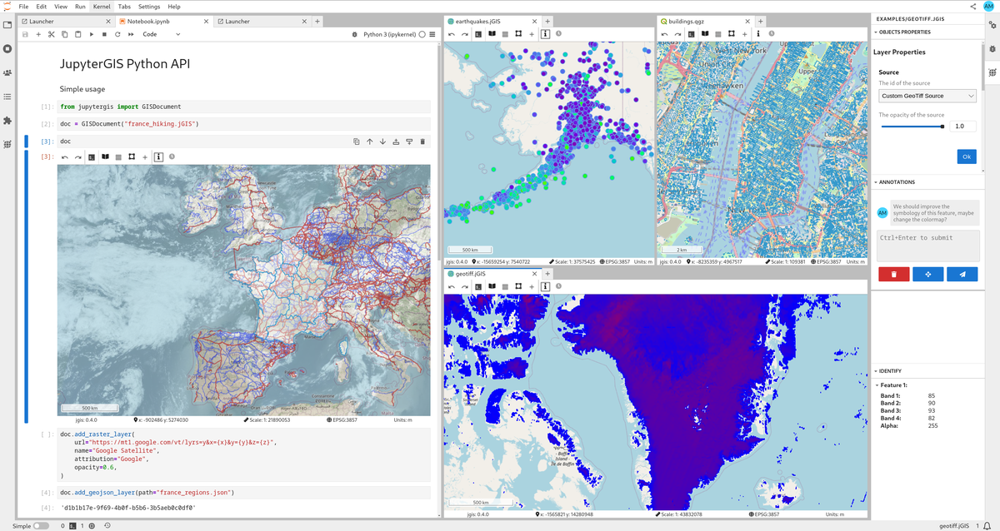
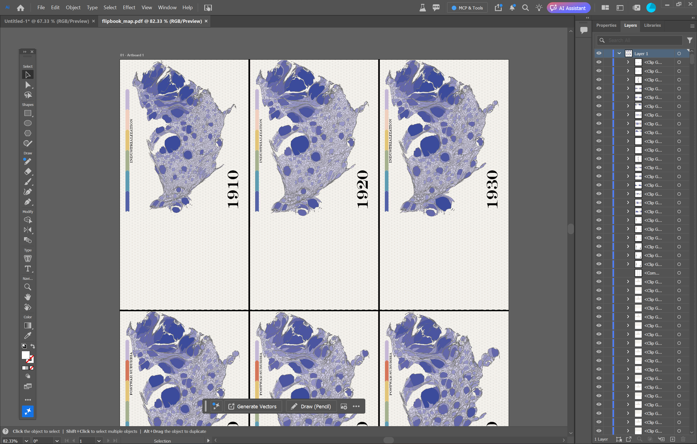
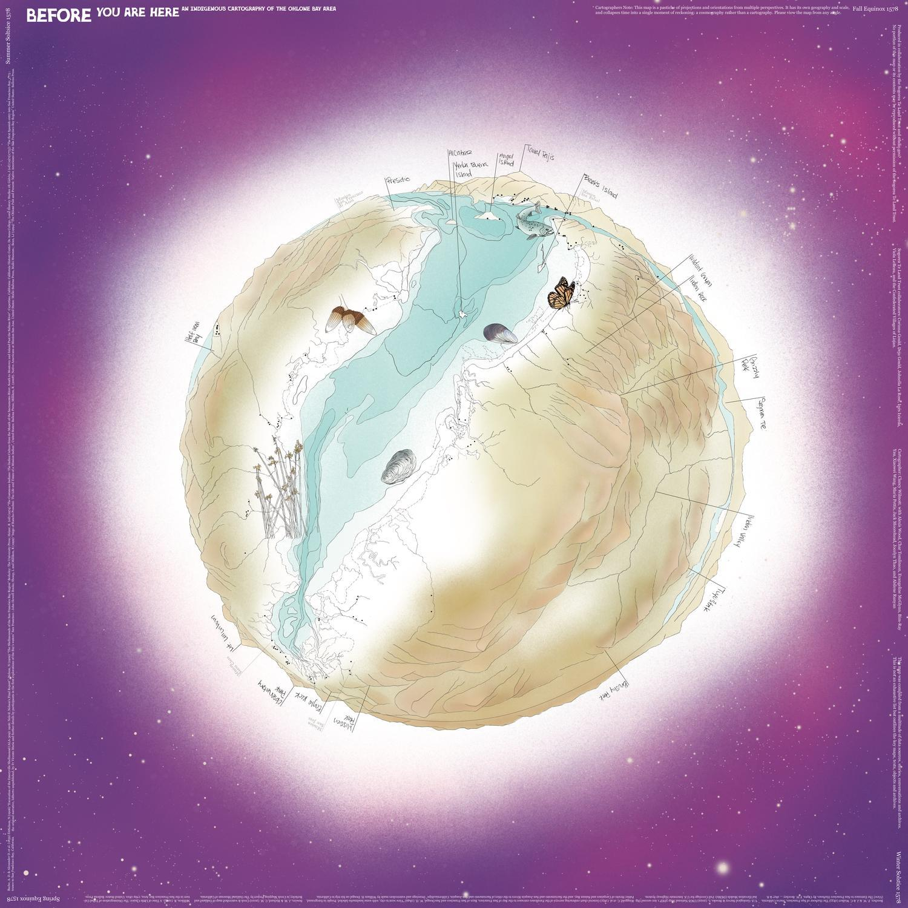
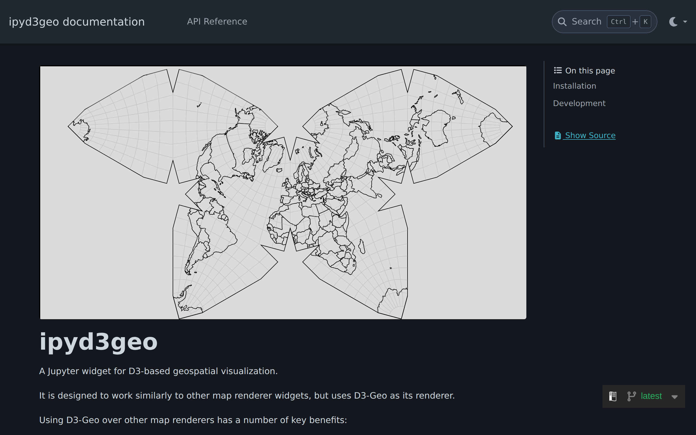
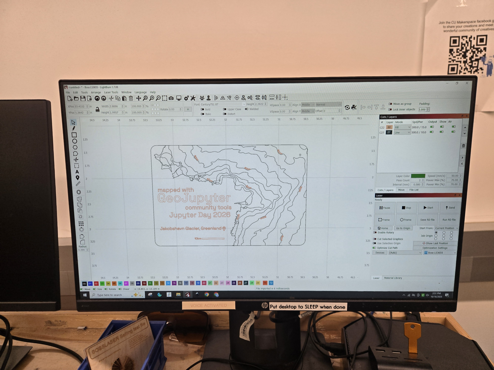
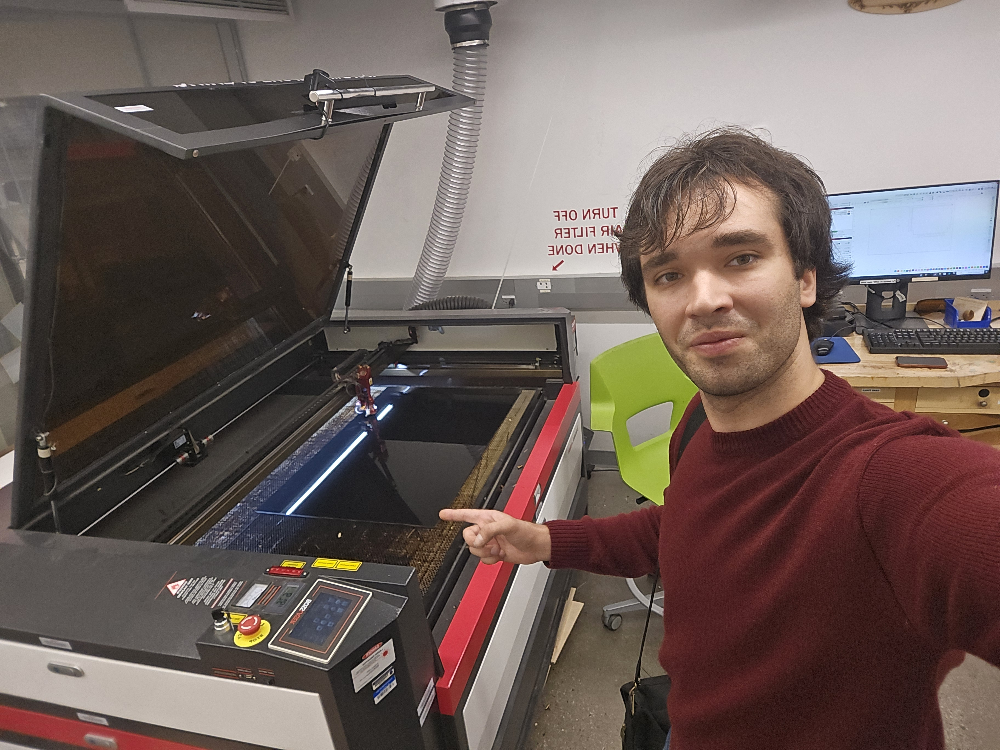

# Cartographers On Your Hub

JupyterDay

Benjamin Szeghy

---

## What is GeoJupyter

GeoJupyter is an open and collaborative community-driven effort to reimagine geospatial interactive computing experiences for education, research, and industry.

We aim to combine the approachability and playfulness of desktop GIS tools, the flexibility and reproducibility of coding-driven GIS methods, and the collaborative and storytelling power of Jupyter to enable more researchers, educators, and learners to confidently engage with geospatial data.

Logo by Isabel Paredes

geojupyter.org

--

## JupyterGIS

JupyterGIS is an in-browser, collaborative Geographical Information System (GIS). It is built on top of Project Jupyter but independently useable.

As flagship project of the open GeoJupyter community it aims to enable organizations, researchers, students, anyone interested to easily explore, use and work with geospatial data.

- Real-time collaboration
- QGIS interoperability
- Python API
- Many data formats
- Grammar-driven symbology
- Storymaps
- AI skills

jupytergis.readthedocs.io

---

## A cartographers workflow

A cartographer's most important tool is a graphic design software

--

### Recieve data from scientific team

--

### Do basic filtering, cropping or similar in a GIS tool

--

### Export to SVG or AIX file

--

### Style into a completed map in Illustrator

--

*Before You Are Here*, Prof. Clancy Wilmott

---

## JupyterGIS is ready

JupyterGIS is more than good enough today to cover the needs of the average cartographer

--

With tools like StratusGeo and similar, the scientists that cartographers collaborate with are already natively working in JupyterHub environments.

TODO: add in StratusGeo (cryocloud) graphics

--

### In this presentation, I will present two things:
- An end-to-end example cartographic workflow using JupyterGIS 
- A new widget, **ipyd3geo**, that acts as a low-friction bridge for cartographers between Jupyter and graphic design software

---

## The workflow

start in StratusGeo

--

open a new JupyterGIS file. in a sidecar notebook, load an icesat2 raster from s3. display it in jupytergis

--

use pandas and rasterio to generate topo lines

--

add back to JGIS and remove the raster.

---

## Introducing ipyd3geo
A cartographers bridge between Jupyter and Vector Graphics editing software

ipyd3geo.readthedocs.io

github.com/geojupyter/prototype-ipyd3geo

--

## Benefits of D3 Geo over other JS map renderers

### 2 "party tricks":
- Best in class projection support
- Renders maps directly to DOM, so exporting to SVG is super easy

--

use ipyd3geo's "from_jgis()" tool to load the layers

--

as a special extra step, conditionally style a couple specific topo line elevation levels to have specific colors. this will come in handy in a bit

--

ipyd3geo's output is dynamic. I can adjust the projection, centering, and zoom to match my taste. 

--

then, I download as svg. 

This is ipyd3geo's unique trick. Because it uses D3 as it's underlying rendering engine, everything is shown by directly manipulating the DOM, with no virtualizaiton. This means exporting vector art formats is basically free.

--

Now, I can load this into illustrator.

--

Here, those special stylings come in handy. I'll use the text on path tool to label their elevations.

--

Then, I'll add some typography and styling.

---

Lastly, the cool part. I can load this svg into LightBurn...

--

And laser cut our map into keychains for you all to take home with you today!

---

## Conclusions

- While JupyterGIS was designed with scientific end users in mind, I posit that a large core user base will be cartographers.
- Cartographers do not need the most powerful, or industry standard, GIS software. For them, lower friction collaboration with scientific colleagues and easier integration with graphic design workflows is more important than the latest and greatest data tools.

--

- JupyterGIS, especially when paired with JupyterAI, already provides tools that are more than good enough to enable the collaboration. Better yet, it allows cartographers to co-locate with scientific partners that already live on a hub.
- ipyd3geo, while still in early stages and no garantee of further development, provides an easy bridge between JupyterGIS and graphic design software.

--

- Further, I hope to start a conversation about non-scientific uses for Jupyter at large. What niche places can they find in our community?
    - Can we find other small missing "bridges" that bring more people into the community?

---

## Questions or Feedback?

Session feedback

geojupyter.org

github.com/geojupyter/prototype-ipyd3geo

